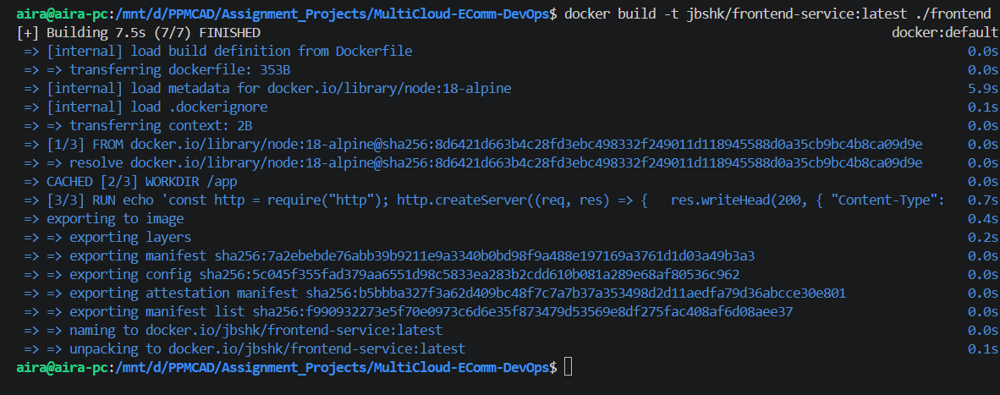
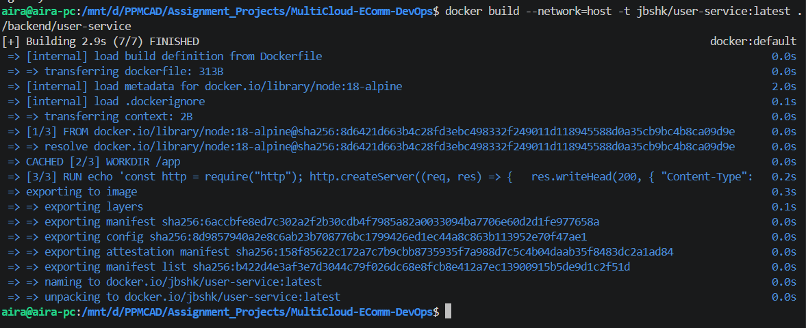
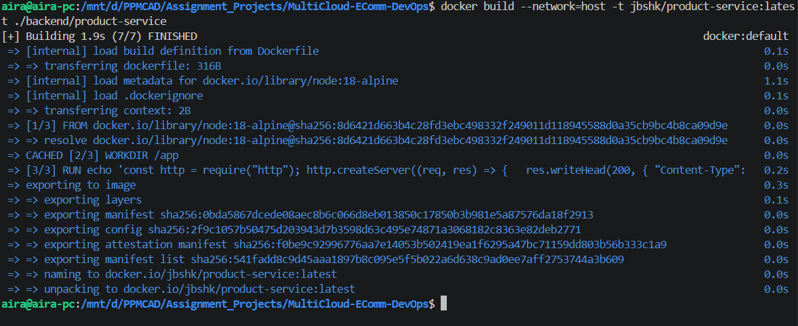
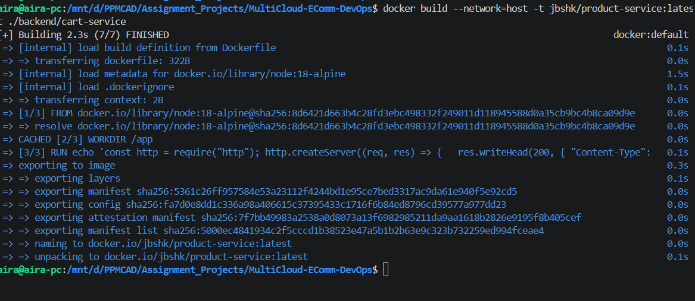
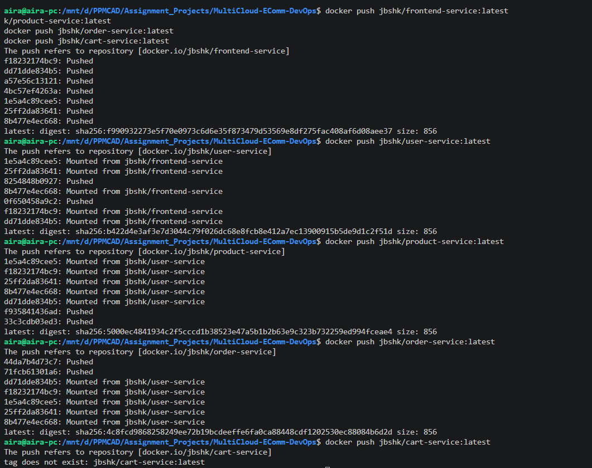
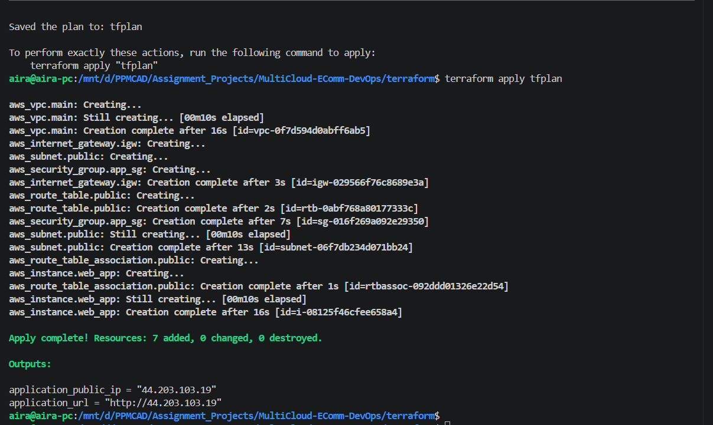
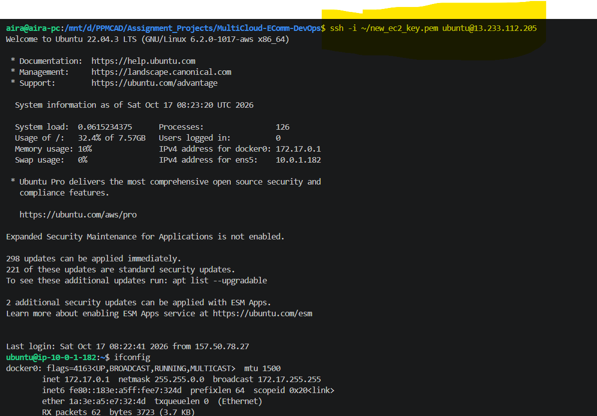
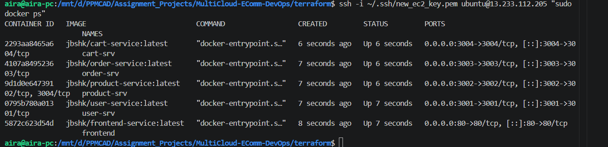
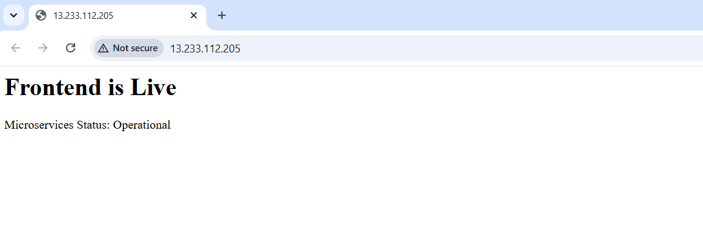
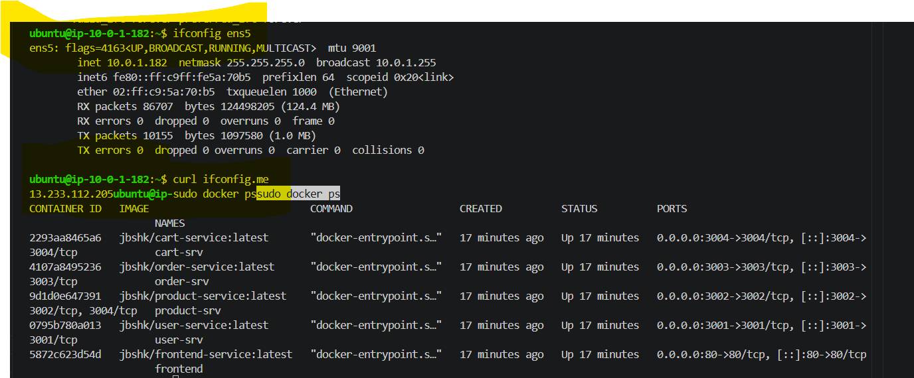

# MultiCloud-EComm-DevOps

An end-to-end automated DevOps capstone blueprint provisioning a resilient, containerized multi-service e-commerce infrastructure on AWS using **Terraform (IaC)**, **Docker Engine**, and **Node.js**.

---

## 🏗️ Architectural Layout & Port Mapping

The platform operates as an isolated microservices container mesh contained inside an AWS custom Virtual Private Cloud (VPC).

*   **Frontend Web Gateway**: Public-facing entry layer handling application presentation traffic. Bound to **Port `80`**.
*   **Backend Application Core Mesh**: Four decoupled, task-oriented microservices communicating internally within the private network boundaries:
    *   **User Service**: Dedicated account domain controller. Internal **Port `3001`**.
    *   **Product Service**: Dynamic inventory processing node. Internal **Port `3002`**.
    *   **Order Service**: Transaction checkout pipeline coordinator. Internal **Port `3003`**.
    *   **Cart Service**: Session-based temporary storage component. Internal **Port `3004`**.

---

## 📸 End-to-End Assignment Completion Proofs

### 📦 1. Automated Local Container Compilation
Every microservice is built using minimalist, secure Alpine Node base layers.
<table>
  <tr>
    <td><strong>Frontend Web Client Build</strong></td>
    <td><strong>User Core Service Build</strong></td>
  </tr>
  <tr>
    <td></td>
    <td></td>
  </tr>
  <tr>
    <td><strong>Product Service Build</strong></td>
    <td><strong>Order Service Build</strong></td>
  </tr>
  <tr>
    <td></td>
    <td></td>
  </tr>
  <tr>
    <td><strong>Cart Service Build</strong></td>
    <td><strong>Registry Push Executions</strong></td>
  </tr>
  <tr>
    <td></td>
    <td></td>
  </tr>
</table>

### 📤 2. Central Image Registry Hosting (Docker Hub)
All compiled application components successfully tracked and hosted under the public `jbshk` repository index namespace.


### 🏗️ 3. Infrastructure as Code Orchestration (Terraform)
VPC subnets, internet gateways, secure routing rules, and compute host servers provisioned in the **Mumbai (`ap-south-1`)** cloud boundary region.
<table>
  <tr>
    <td><strong>VPC Infrastructure State Initialization</strong></td>
    <td><strong>Active Provisioning Final Outputs</strong></td>
  </tr>
  <tr>
    <td></td>
    <td></td>
  </tr>
</table>

### 🛡️ 4. AWS Console Security Verification
The custom security group mapping verifies that only administrative maintenance vectors (Port `22`) and web inputs (Port `80`) are exposed externally, keeping backend engines private.


### 🚀 5. Runtime Container Validation (`docker ps`)
SSH connection metrics verification verifying that the automated initialization configurations successfully deployed the target image stack inside the remote compute host.
<table>
  <tr>
    <td><strong>Target Instance Context Session</strong></td>
    <td><strong>Active Container Grid Tracking Logs</strong></td>
  </tr>
  <tr>
    <td></td>
    <td></td>
  </tr>
</table>

### 🌐 6. Public Accessibility & Service Verification
Live platform checks confirm public availability alongside clean endpoint checks across backend logic ports.
<table>
  <tr>
    <td><strong>Live Public Web Interface</strong></td>
    <td><strong>Instance Health Metrics</strong></td>
  </tr>
  <tr>
    <td></td>
    <td></td>
  </tr>
</table>

---

## 🚀 Step-by-Step Deployment Lifecycle

### Phase 1: Local Engineering Setup (Manual Container Build)
1. Initialize target codebase paths:
   ```bash
   export DOCKER_USER="jbshk"
   ```
2. Run automated image build sequence:
   ```bash
   docker build -t \$DOCKER_USER/frontend-service:latest ./frontend
   docker build -t \$DOCKER_USER/user-service:latest ./backend/user-service
   docker build -t \$DOCKER_USER/product-service:latest ./backend/product-service
   docker build -t \$DOCKER_USER/order-service:latest ./backend/order-service
   docker build -t \$DOCKER_USER/cart-service:latest ./backend/cart-service
   ```
3. Upload baseline execution layers upstream to the Docker Hub registry:
   ```bash
   docker login -u jbshk
   docker push jbshk/frontend-service:latest
   docker push jbshk/user-service:latest
   docker push jbshk/product-service:latest
   docker push jbshk/order-service:latest
   docker push jbshk/cart-service:latest
   ```

### Phase 2: Automated Infrastructure Provisioning (Terraform)
1. Step into the cloud infrastructure layout folder directory:
   ```bash
   cd terraform
   ```
2. Initialize plugins, compile resources execution path, and deploy live on AWS:
   ```bash
   terraform init
   terraform plan -out=tfplan
   terraform apply tfplan
   ```

---

## 🕵️‍♂️ Post-Deployment Validation Diagnostics

Verify all local service engines across the private mesh directly over your secure connection tunnel:
```bash
# Evaluate runtime statuses across internal application logic port boundaries
ssh -i ~/.ssh/new_ec2_key.pem ubuntu@13.233.112.205 "curl -s http://localhost:3001" # User Service
ssh -i ~/.ssh/new_ec2_key.pem ubuntu@13.233.112.205 "curl -s http://localhost:3002" # Product Service
ssh -i ~/.ssh/new_ec2_key.pem ubuntu@13.233.112.205 "curl -s http://localhost:3003" # Order Service
ssh -i ~/.ssh/new_ec2_key.pem ubuntu@13.233.112.205 "curl -s http://localhost:3004" # Cart Service
```
